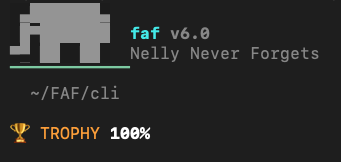

<!-- faf: faf-cli | TypeScript | cli | CLI for the .faf and .fafm IANA-registered formats — AI context + memory that versions with your code -->
<!-- faf: doc=readme | canonical=project.faf | score=100 | family=FAF -->

<div align="center">

<h1>
<br>
faf-cli<br>
<sub><sub>CONTEXT, versioned.</sub></sub>
</h1>

### The context every AI coding agent reads — authored from your repo, never guessed.

**One `.faf` file → `AGENTS.md` · `CLAUDE.md` · `GEMINI.md` · `.cursorrules`,<br>
detected from your real stack, scored, and versioned with your code. No drift. No re-explaining.**

<!-- ① PRIME — the crown receipts -->
[](https://github.com/modelcontextprotocol/servers/pull/2759)
[](https://www.iana.org/assignments/media-types/application/vnd.faf+yaml)
[](https://www.iana.org/assignments/media-types/application/vnd.fafm+yaml)
[](https://www.iana.org/assignments/media-types/application/vnd.fafa+yaml)
[](https://github.com/hesreallyhim/awesome-claude-code)
[](https://www.npmjs.com/package/faf-cli)
[](https://www.npmjs.com/package/faf-cli)
[](https://wolfe-jam.github.io/agent-business-card/?repo=Wolfe-Jam/faf-cli)

<br>

[](https://faf.one/downloads) · across npm, PyPI and crates.io · **IANA-registered · Anthropic-merged (#2759)**

⭐ [Star it on GitHub](https://github.com/Wolfe-Jam/faf-cli): bookmarks it for you, helps other devs find it too.

<!-- ② papers · funnel · testing — one line -->
[](https://doi.org/10.5281/zenodo.18251362)
[](https://doi.org/10.5281/zenodo.20348942)
[](https://github.com/Wolfe-Jam/faf)
[](https://github.com/Wolfe-Jam/faf-taf-git)
[](https://github.com/Wolfe-Jam/faf-cli/actions/workflows/ci.yml)

FAF defines. AGENTS.md instructs. AI codes.

<!-- trophy — bottom of hero -->
[](https://faf.one)

</div>

```
project/
├── package.json     ← npm reads this
├── project.faf      ← AI reads this
├── README.md        ← humans read this
└── src/
```

> **Every building requires a foundation. FAF is AI's foundational layer.**
>
> You have a `package.json`. AI needs you to add a `project.faf`. Done.

**Git-Native.** `project.faf` versions with your code — every clone, every fork, every checkout gets full AI context.<br>
No setup, no drift, no re-explaining.

---

## Install

```bash
bunx faf auto                 # Bun — zero install, fastest path
npx faf auto                  # npm — works everywhere
pnpm dlx faf auto             # pnpm — zero install
brew install wolfe-jam/faf/faf-cli && faf auto   # Homebrew (auto-taps)
```

> `faf` with no arguments shows your project's score. `faf auto` fills what it detects in the repo, and suggests the goal and six W's for you to confirm in `faf go`.

---

## Quick Start

```bash
# ANY GitHub repo — one shallow clone, no install, 2 seconds
bunx faf-cli git https://github.com/facebook/react

# Your own project
bunx faf-cli init              # Create .faf
bunx faf-cli auto              # Fill the tech slots from the repo, then score
bunx faf-cli go                # Confirm the goal and six W's, suggested in gray
```

---

## Nelly Never Forgets

Run `faf` with no arguments:



> **faf-cli dogfoods itself** — [project.faf](./project.faf) is source DNA; [CLAUDE.md](./CLAUDE.md) and [GEMINI.md](./GEMINI.md) are authored from it via `faf`. [AGENTS.md](./AGENTS.md) is the **BETTER** ops briefing (hand-kept for agents; `faf export --agents` still authors AGENTS.md for other repos).

---

## Commands

| Command | What it does |
|---------|--------------|
| `faf init` | Create `project.faf` from your local project; suggest the goal and six W's |
| `faf git <url>` | Instant `.faf` from any GitHub repo (a shallow clone) |
| `faf auto` | Detect the stack, fill the slots it detects, score; suggest the goal and six W's |
| `faf go` | Fill the human slots: each suggestion in gray, Tab to edit, Enter to confirm |
| `faf score` | Check AI-readiness (0–100%) |
| `faf export` | Author `AGENTS.md`, `CLAUDE.md`, `GEMINI.md`, `.cursorrules` |
| `faf sync` | `.faf` → `CLAUDE.md`, one way (faf's block only) |
| `faf memory` | `.fafm` soul ops — convert Claude memory, etch, recall, ls, show |
| `faf diff` / `log` | Semantic context diff + score timeline across git history |
| `faf hooks --install` | Pre-commit guard against context regression |
| `faf taf setup` | Write the CI workflow that prints a Test Receipt for every run (JavaScript with Jest, Vitest or Bun; Python; Go; Rust; Java with Maven or Gradle; .NET) |
| `faf taf receipts` | Your Test Receipts in the terminal, newest first |
| `faf compile` / `decompile` | `.faf` → `.fafb` **v2** sealed brick; `decompile` shows sections as JSON |
| `faf check` | Validate a `.faf` file |
| `faf show` | Render `project.faf` to a browsable HTML page |
| `faf formats` | List supported stacks and formats |

Run `faf --help` for the full command set and options.

### Memory (`.fafm`)

Portable agent memory in the IANA-registered [`.fafm`](https://www.iana.org/assignments/media-types/application/vnd.fafm+yaml) format. Same INTEROP as [claude-fafm-sdk 1.0](https://pypi.org/project/claude-fafm-sdk/).

```bash
# Claude Code memory dir → soul.fafm
faf memory convert ~/.claude/projects/.../memory -o soul.fafm

faf memory ls                    # ranked facts
faf memory recall "your query"   # deterministic filter + rank
faf memory etch "a durable fact" --id my-fact
faf memory show
```

### What's New in v8.10.0 — The Human Slots Edition

**AI suggests, you confirm. faf no longer writes your project's goal or six W's: it suggests them, and you confirm each one in `faf go`.**

- **Suggestions in gray.** `faf go` shows each suggestion with where it came from (`README.md § Why`, `package.json description`). Tab to edit, Enter to confirm, type to replace, `skip` to leave it empty. `faf init`, `faf auto` and `faf git` say how many are waiting.
- **Only facts are suggested.** Markup, greetings, install lines and fragments are rejected; a notice (deprecated, sponsored by, requires…) is never the goal; a long first paragraph gives its first sentence, whole. The README leads the goal.
- **faf-facts.** The six W's ask for one line where every word earns its place. `how` is how it works; `when` is the stage it is at, and since when.
- **Breaking for library users:** `assembleFreshFaf`, `updateExistingFaf` and `authorFafFromRepo` return the goal and six W's empty. Files you already have are not changed.
- **`faf go` input.** Backspace removes a whole character (emoji, CJK), other questions use readline again, and piped answers are read in order.

Earlier editions: [CHANGELOG.md](./CHANGELOG.md) · [Releases](https://github.com/Wolfe-Jam/faf-cli/releases)

---

## Custom instructions

Your own rules for the AI — *"use full words in identifiers," "use bun, not npm"* — go in `project.faf` under `ai_instructions.warnings`. They land at the top of every `AGENTS.md` faf writes, verbatim and non-destructive.

**→ [How to add custom rules](https://docs.faf.one/custom-rules)** · [docs.faf.one](https://docs.faf.one)

---

## Scoring

**✪ Trophy 100% — all or nothing.** From v6.6.0 onward, faf-cli recommends only Trophy. 100% on the FCL is what makes the layers above (MD instructions, Agents, AI tooling) work — sub-Trophy leaves gaps that AI guesses on. Sub-Trophy tiers (including Bronze 85) remain on the ladder as honest interim states — they are not deleted; we just no longer *aim* for 85 as the goal.

| Tier | Score | Status |
|------|-------|--------|
| ✪ **Trophy** | 100% | AI never has to guess — target |
| ★ **Gold** | 99%+ | 1 slot from Trophy |
| ◆ **Silver** | 95%+ | Close — keep going |
| ◇ **Bronze** | 85%+ | On the ladder (was the old recommend-min; not the target) |
| ● **Green** | 70%+ | Interim — keep going |
| ● **Yellow** | 55%+ | AI flipping coins |
| ○ **Red** | <55% | AI working blind |
| ♡ **White** | 0% | No context at all |

**Always-33.** The score is filled ÷ active across all 33 Mk4 slots. Your app-type decides which slots are active; the rest are `slotignored` and stay visible. Same file, same engine, same number — see [docs/SCORING.md](./docs/SCORING.md).

**One score, three glyphs:** ✪ work (CLI · docs · receipts) · 🏆 social (X · blogs) · Trophy Mark PNG (brand). Source of truth: `src/core/tiers.ts`.

---

## Sync

```
sync:      .faf  ───→  CLAUDE.md   (one way: faf's block only)
tri-sync:  .faf  ───→  CLAUDE.md + Claude Code's MEMORY.md   (Pro: faf's block only; Claude's notes kept)
```

---

## Docs

The full manual lives at **[docs.faf.one](https://docs.faf.one)** — facts for devs, faf-cli first. One-page overview: **[faf-cli.vercel.app](https://faf-cli.vercel.app)**.

- [Getting started](https://docs.faf.one/getting-started) — install · run · use
- [Cards](https://docs.faf.one/cards) — one `.fafa` → A2A · Server Card · registry · AI Catalog · ARD
- [Custom rules](https://docs.faf.one/custom-rules) — pin instructions your AI must follow

For a specific agent: [Grok, xAI & Cursor 👀](docs/faf-cli-for-agents.md) · [Claude Code 👀](docs/faf-cli-for-claude.md) · [Bun 👀](docs/faf-cli-for-bun.md)

---

## Recent editions

Pivotal releases — full history in [CHANGELOG.md](./CHANGELOG.md):

- **v8.10 — Human Slots** — AI suggests the goal and six W's; you confirm each one in `faf go`.
- **v8.9 — Write-Once** — a birth certificate that can't be reissued, checked against its birth commit.
- **v8.0 — Always33** — one engine, one number: the same score everywhere.
- **v7.1 — AGENTS.md** — `faf export --agents` authors a complete, non-destructive `AGENTS.md`.
- **v7.0 — GIT** — context goes git-native: `faf diff` / `log` / `hooks`.
- **v6.16 — Know Your Stack** — every emitted file labels your stack identically.
- **v6.15 — Copilot** — `faf export --copilot` writes the file GitHub Copilot reads.
- **v6.14 — Loop** — `faf loop` drives any repo to ✪ 100% or the honest human wall.
- **v6.7 — HTML** — `faf show` renders a `.faf` to a browsable page. *(FAF defines. AGENTS.md instructs. AI codes. HTML shows.)*
- **v6.6 — Trophy** — 100% or nothing.
- **v6.0 — Bun** — ground-up rewrite; single portable binary, four platforms.

---

## Compiled Binaries

Bun's single-file compiler produces standalone binaries — no runtime needed.

```bash
bun run compile                # Current platform
bun run compile:all            # darwin-arm64, darwin-x64, linux-x64, windows-x64
```

Ship `faf` as a single binary for CI/CD, Docker, or air-gapped environments.

---

## Architecture

```
src/
├── cli.ts              ← Entry point (Commander registrations)
├── commands/           ← one file per faf subcommand
├── core/               ← Types, slots (Mk4), tiers, scorer, schema
├── detect/             ← Framework detection, stack scanner
├── interop/            ← YAML I/O, CLAUDE.md, AGENTS.md, GEMINI.md
├── ui/                 ← Colors (#00D4D4), display
└── wasm/               ← faf-scoring-kernel wrapper (Rust → WASM)
```

**Toolchain:** Bun (test, build, compile) · TypeScript (strict) · WASM (scoring kernel)

---

## Testing

> **Robust. Reliable. Next-level WJTTC tested.** — The Foundation Edition.

```bash
npm test                       # extensive WJTTC + e2e suite
```

- **WJTTC Build Resilience** — regression classes locked.
- **WJTTC Kernel Stress** — WASM kernel boundary tests.
- **e2e lifecycle** — commands in sequence.

Test reports in `reports/`.

---

## Support

- **[GitHub Discussions](https://github.com/Wolfe-Jam/faf-cli/discussions)** — Questions, ideas, community
- **Email:** team@faf.one

If `faf-cli` has been useful, consider starring the repo — it helps others find it.

---

## Citation

If you use `faf-cli` or the `.faf` / `.fafm` / `.fafa` formats in research or production, please cite the format papers:

> Wolfe, J. (2025). *Format-Driven AI Context Architecture: The .faf Standard for Persistent Project Understanding*. Zenodo. https://doi.org/10.5281/zenodo.18251362

> Wolfe, J. (2026). *Permanent Memory and Instant Recall: The .fafm Standard for Multi-Profile AI Agent Memory*. Zenodo. https://doi.org/10.5281/zenodo.20348942

> Wolfe, J. (2026). *Why Agents Need a Passport: .fafa — Portable Identity for the Agentic Era*. Zenodo. https://doi.org/10.5281/zenodo.21951641

### BibTeX

```bibtex
@article{wolfe2025faf,
  title     = {Format-Driven AI Context Architecture: The .faf Standard for Persistent Project Understanding},
  author    = {Wolfe, James},
  year      = {2025},
  month     = {nov},
  publisher = {Zenodo},
  doi       = {10.5281/zenodo.18251362},
  url       = {https://doi.org/10.5281/zenodo.18251362}
}

@article{wolfe2026fafm,
  title     = {Permanent Memory and Instant Recall: The .fafm Standard for Multi-Profile AI Agent Memory},
  author    = {Wolfe, James},
  year      = {2026},
  month     = {may},
  publisher = {Zenodo},
  doi       = {10.5281/zenodo.20348942},
  url       = {https://doi.org/10.5281/zenodo.20348942}
}

@article{wolfe2026fafa,
  title     = {Why Agents Need a Passport: .fafa — Portable Identity for the Agentic Era},
  author    = {Wolfe, James},
  year      = {2026},
  month     = {aug},
  publisher = {Zenodo},
  doi       = {10.5281/zenodo.21951641},
  url       = {https://doi.org/10.5281/zenodo.21951641}
}
```

## License

MIT — Free and open source

**IANA-registered:** [`application/vnd.faf+yaml`](https://www.iana.org/assignments/media-types/application/vnd.faf+yaml) (Context Layer) · [`application/vnd.fafm+yaml`](https://www.iana.org/assignments/media-types/application/vnd.fafm+yaml) (Memory Layer) · [`application/vnd.fafa+yaml`](https://www.iana.org/assignments/media-types/application/vnd.fafa+yaml) (Agent Layer)

*format | driven 🏎️⚡️ [wolfejam.dev](https://wolfejam.dev) · [faf.one/cli](https://faf.one/cli)*

<div align="center">

[](https://opensource.org/licenses/MIT)
[](https://github.com/Wolfe-Jam/homebrew-faf)

</div>
